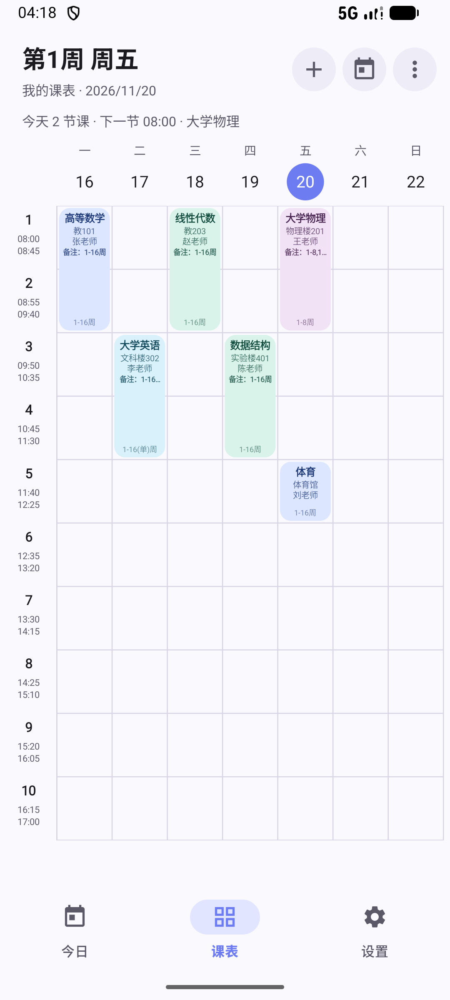
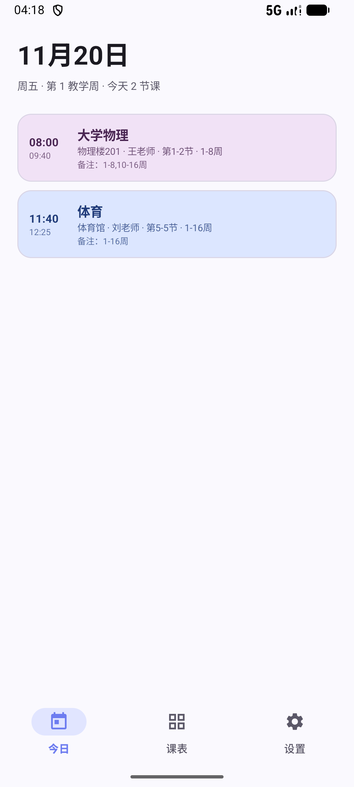
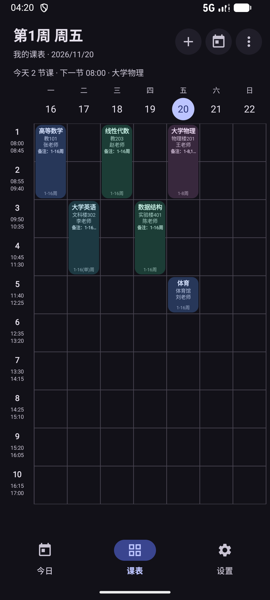

# 小陈课表 · ChenClasstable

* 一款本地优先的 Android 课表应用：把学校教务系统的课表导入手机，支持按周 / 按天查看。课程可编辑、删除，无需账号，课表也不会上传到服务器。

---

## 制作背景

* 本人因受不了大多数课表软件乱七八糟的~~狗屎~~构式一般***广告***（祝发明摇一摇广告的人死全家！），所以决定通过鞭策AI制作该应用。
* 该应用仅7mb左右大小，安装完并设置课表后最多不超过50mb!（比大多数课表应用占用小！）。

---

## 下载
[蓝奏云](https://yangyibo.lanzouw.com/i0mjQ4gptnfi)密码:b1m4,手机下载不了将手机浏览器UA改为电脑端！

## 界面预览

|课表页|今日页|深色课表|
|-|-|-|
||||

## 主要功能

### 多课表，各自独立

* 可以新建、切换、删除多份课表，例如「本学期」「辅修」「实验课」。
* **每份课表可单独设置开学时间、学期周数、节数和每节时间，以及是否显示周末、是否显示表格线。**
* 切换课表后会自动使用该课表的设置；切回原课表时，原设置不变。
* 深色模式、课程配色、界面缩放属于全 App 通用设置。

### 课表导入

* 目前仅支持一种导入方式：**WebView 登录采集** —— 在 App 内打开学校教务网页并登录，采集课表页后在本地解析。

### 周次与今日

* 当前周由「开学日期 + 当天日期」自动计算，不需要每周手动调整。
* 单周、双周、起止周都会正确过滤。
* 课表页左右滑动可切换上一周 / 下一周，右上角的按钮可以回到本周。
* 今日页显示今天的课程、时间和备注。
* 开学前会显示「还没开学呢！」；学期课程全部结束后，会显示「本学期的课程已全部完成」。
* 点击今日课程卡不会打开详情页，但备注会直接显示在卡片上。

### 课程详情与编辑

点击课表里的课程块，底部会弹出课程详情：

* 周数、星期、节次与上课时间、教室、教师、备注；
* **编辑**：进入完整编辑页，预填真实课程数据；
* **删除**：可选择「仅删除第 N 周」或「删除所有周」，选择后还有二次确认。

仅删除所选周次时，会在不改变课程数据结构的前提下拆分周段，保留其他周次、单双周规则、备注、教师、教室和时间。

### 外观与显示

* 浅色与深色主题均完整适配；
* 界面缩放 80%–120%，可恢复默认；
* 布局密度：宽松 / 标准 / 紧凑；
* 缩放比例过高时会弹出提醒和确认；
* 可隐藏表格网格线，课程块和时间轴仍会保留；
* 可显示或隐藏周末。

---

## 编译环境

### 环境

|项目|版本|
|-|-|
|JDK|17|
|Gradle|8.0（仓库自带 Gradle Wrapper）|
|Android Gradle Plugin|8.1.0|
|Kotlin|1.9.22|
|compileSdk / targetSdk|34|
|minSdk|21|

### 构建

Windows：

```bat
gradlew.bat assembleDebug
```

macOS / Linux：

```bash
./gradlew assembleDebug
```

APK 输出：

```text
app/build/outputs/apk/debug/ChenClasstable-debug.apk
```

用 Android Studio 打开项目根目录，等待 Gradle Sync 完成后运行即可。

---

## 项目结构

```text
ChenClasstable/
├── app/src/main/java/com/chen/classtable/
│   ├── MainActivity.kt                今日 / 课表 / 设置三个主页面
│   ├── ImportActivity.kt              导入页与导入流程
│   ├── WebViewLoginActivity.kt        教务网页登录与采集
│   ├── ScheduleGridView.kt            课表网格（自定义 Canvas View）
│   ├── WeekStripView.kt               星期日期条
│   ├── CourseDetailSheet.kt           课程详情 Bottom Sheet
│   ├── CourseEditActivity.kt          课程编辑页
│   ├── ScheduleSettingsActivity.kt    当前课表的独立设置
│   ├── PeriodTimesActivity.kt         节数与每节时间
│   ├── AppearanceActivity.kt          外观设置
│   ├── AboutActivity.kt               关于页
│   ├── AppSettings.kt                 应用级与课表级设置存取
│   ├── capture/、importer/、parser/    网页采集、导入与 HTML 解析
│   ├── model/、store/、rule/          课程模型、存储、周次规则
│   └── registry/                      教务系统类型注册
├── app/src/main/res/                  布局、图标、主题、颜色
├── app/src/main/assets/               演示教务页与采集测试页
├── screenshots/                       实际运行截图
├── docs/design-v2/                    设计过程与实现记录
├── build.gradle / settings.gradle     Gradle 配置
└── ChenClasstable-debug.apk           当前调试安装包
```

---

## 数据与隐私

课程、课表和应用设置均使用 SharedPreferences 保存在本机：

* 没有账号系统，没有云同步，也不会上传课程数据；
* 仅申请 `INTERNET` 权限，用于打开学校教务网页；
* 采集的网页只在本地解析，临时文件用完即删。

---

## 已知限制

* 目前仅适配正方教务系统（如长春职业技术大学），其他教务系统仍在适配。
* webview界面仍在处于开发阶段。
* 颜色设置仍有一定问题。

---

## 版本与说明

* 当前版本：**v1.1**
* 桌面显示名称：**小陈课表**
* 包名：`com.chen.classtable`
* 本项目为本地课表工具，由 DeepSeek 辅助开发；界面和交互参考了通用课表应用的设计思路，课表解析、存储和界面代码均在本工程内实现。

